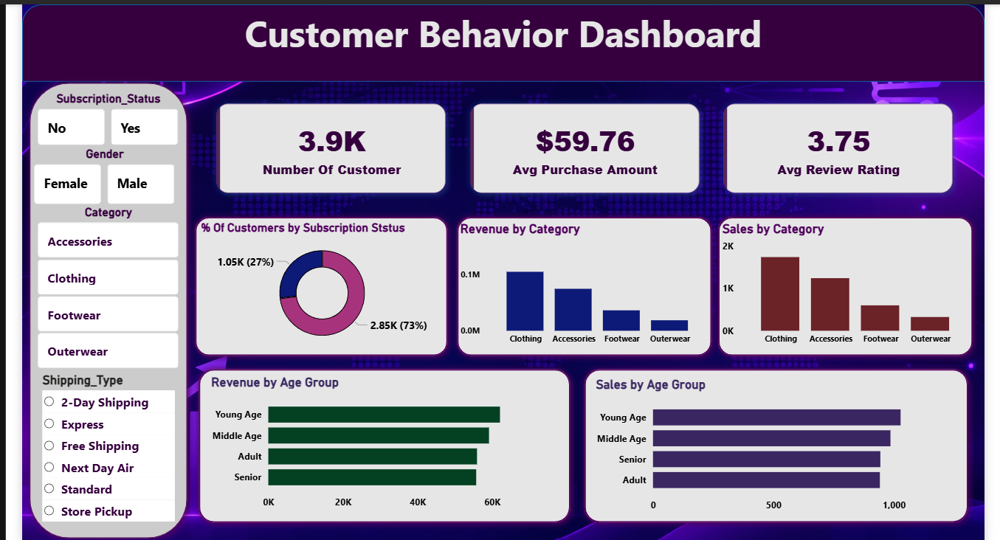

# 📊 Customer Behaviour Analysis | Python • PostgreSQL • Power BI

<p align="center">
  <strong>Turning Customer Data into Meaningful Business Insights</strong>
</p>

<p align="center">
  
  
  
  
</p>

---

## 📌 Project Overview

Customer Behaviour Analysis is an end-to-end data analytics project focused on understanding customer purchasing patterns, preferences and spending behaviour.

The project uses Python for data cleaning and exploratory data analysis, PostgreSQL for database management and SQL-based business analysis, and Power BI to create an interactive dashboard.

The main objective is to transform raw customer data into meaningful insights that can help businesses understand their customers and make better data-driven decisions.


## 🖥️ Dashboard Preview

<p ## 🖥️ Dashboard Preview

<p align="center">
  
</p>


---

## 🎯 Project Objectives

- Understand customer purchasing behaviour and preferences.
- Analyze customer spending patterns.
- Identify popular product categories.
- Compare revenue and sales across different age groups.
- Analyze subscription status and customer distribution.
- Explore the relationship between customer ratings and purchasing patterns.
- Present meaningful insights through an interactive dashboard.

## 🛠️ Tools & Technologies

| Tool | Purpose |
|---|---|
| Python | Data cleaning, preprocessing and EDA |
| Pandas & NumPy | Data manipulation and analysis |
| Matplotlib & Seaborn | Exploratory data visualization |
| PostgreSQL | Database management |
| SQL | Business queries and data analysis |
| Power BI | Interactive dashboard development |

---

## 🔄 Project Workflow

**1. Data Collection**
- Imported the customer shopping behaviour dataset.

**2. Data Cleaning – Python**
- Checked missing values and duplicates.
- Handled data inconsistencies.
- Prepared the dataset for analysis.

**3. Exploratory Data Analysis – Python**
- Analyzed customer demographics.
- Explored purchasing patterns and spending behaviour.
- Identified trends across product categories.

**4. Database Management – PostgreSQL**
- Created the database and imported the cleaned dataset.
- Performed SQL-based business analysis.
- Used filtering, grouping, aggregation and joins where applicable.

**5. Dashboard Development – Power BI**
- Designed an interactive dashboard.
- Created KPI cards and visualizations.
- Added slicers for dynamic customer analysis.

---

## 📈 Dashboard Highlights

| Visualization | Business Purpose |
|---|---|
| Total Customers | Understand customer distribution |
| Average Purchase Amount | Measure average customer spending |
| Average Review Rating | Understand customer satisfaction |
| Subscription Analysis | Compare subscribed and non-subscribed customers |
| Revenue by Category | Identify revenue contribution by category |
| Sales by Category | Compare product category sales |
| Revenue by Age Group | Understand spending across age groups |
| Sales by Age Group | Compare purchasing activity across age groups |

### 🎛️ Interactive Filters

The dashboard includes slicers for:

- Subscription Status
- Gender
- Product Category
- Shipping Type

These filters allow users to explore customer segments dynamically.

---

## 🗄️ SQL Business Analysis

The following business questions were explored during the analysis:

1. What is the total number of customers?
2. What is the average purchase amount?
3. Which product categories generate the highest revenue?
4. Which age group contributes the most revenue?
5. How are customers distributed by gender?
6. What percentage of customers have active subscriptions?
7. Which product categories receive better customer ratings?
8. How do shipping preferences vary among customers?
9. What are the purchasing patterns across different customer segments?

---

## 💡 Key Learning Outcomes

- Gained practical experience in end-to-end data analysis.
- Improved Python data cleaning and EDA skills.
- Practiced writing SQL queries for business problems.
- Learned to connect analytical results with Power BI.
- Developed an interactive dashboard using KPIs, charts and slicers.
- Improved my ability to communicate data through visual storytelling.

---

## 📂 Project Structure

```text
Customer_Behaviour_Dashboard/
│
├── Customer_pbi.png
├── DA_project.ipynb
├── sql_DA_Customer.ipynb
├── customer_shopping_behavior.csv
└── README.md
```

---

## 🚀 Future Improvements

- Add customer segmentation using RFM analysis.
- Perform deeper customer retention analysis.
- Explore predictive analytics for customer purchasing behaviour.
- Add more advanced DAX measures and dashboard insights.

---

## 👩‍💻 About Me

**Sneha K**

Aspiring Data Analyst | Python | SQL | Power BI

I am passionate about exploring data, identifying patterns and transforming raw information into meaningful business insights. This project is part of my continuous learning journey in Data Analytics.

---

<p align="center">
  ⭐ If you find this project useful, feel free to explore the repository and share your feedback!
</p>
